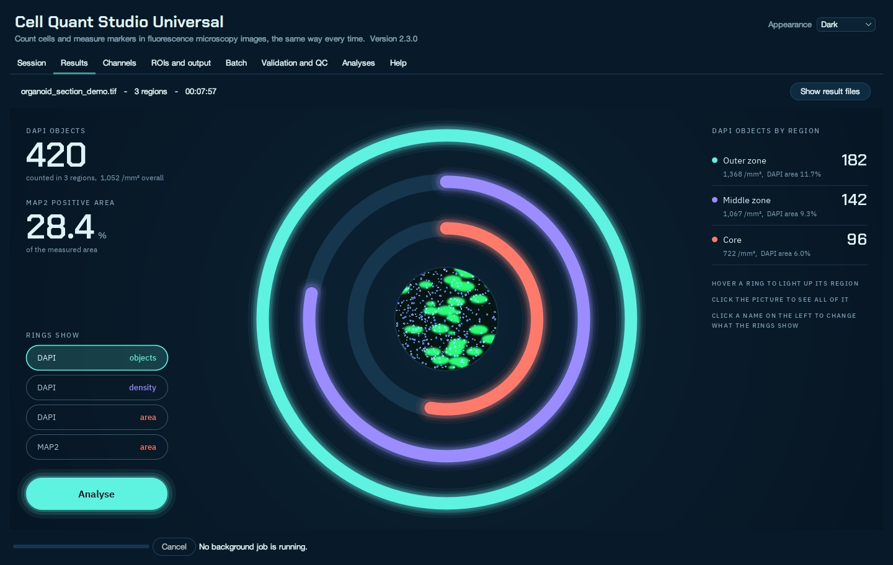
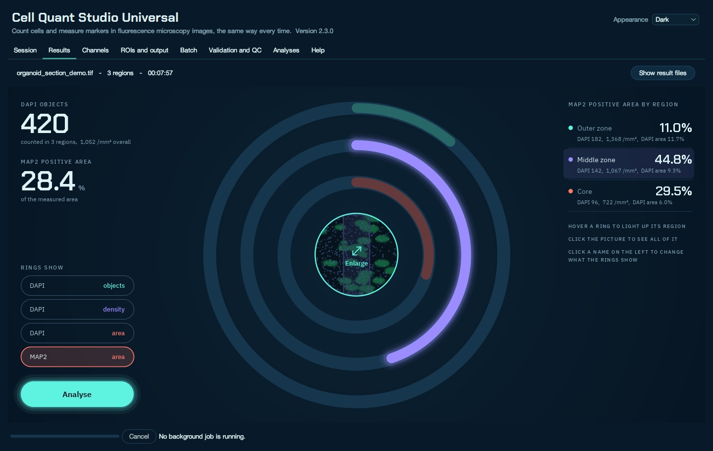
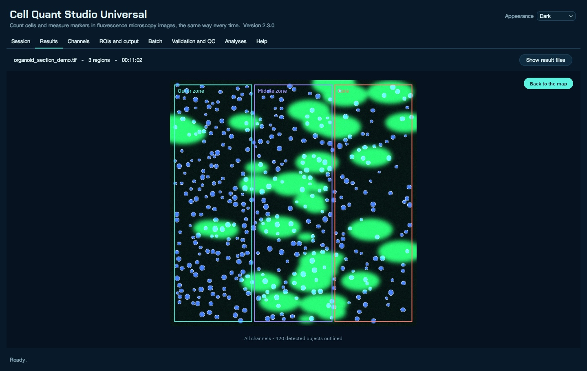
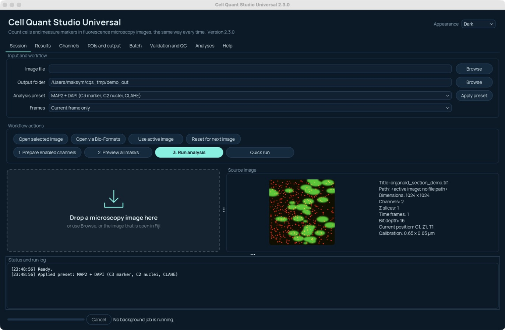

# Cell Quant Studio Universal

**Reproducible, validated quantification of multichannel fluorescence images in Fiji/ImageJ, built for brain organoid sections.**

Cell Quant Studio combines image preparation, independent channel segmentation and ROI-based quantification in one window. You set channel assignments, processing steps, thresholds and analysis modes in the interface, save them as a reusable settings profile, and apply the same procedure to single images or to whole folders. Every run records the exact settings, thresholds and software versions next to its results.

It measures nuclear-object counts, marker-positive area and fluorescence intensity inside parent regions of any shape. DAPI and markers such as MAP2 are analyzed independently, so a nuclear segmentation does not decide the area measured in a non-nuclear marker channel.

Built-in tools check the results: object counts against manual point marks, masks against reference masks, and how strongly results depend on each setting. Optional analyses add:

- an automatic tissue outline;
- depth profiles from the organoid surface;
- marker coverage across all thresholds;
- tuning of settings against manual marks, scored on held-out fields;
- error-corrected counts with uncertainty;
- a robustness report showing whether a group difference holds across many defensible settings.

> **Version 2.3.0.** This version has been run and tested in a real Fiji (Jython 2.7.4, ImageJ 1.54p, Java 21) and on the author's Zeiss CZI images. Upgrading from 2.2.x? Read [CHANGELOG.md](CHANGELOG.md) first: some results change on purpose. The earlier macros are kept in [legacy/](legacy/) and are not covered here.



*The Results tab after an analysis of a synthetic test image.*

## Look and Results tab

- **Results tab: the organoid map.** After "3. Run analysis" the window shows the run as one picture.
  - **In the middle**, wide rings, one per parent ROI (the first eight), from the outside in. The arc of a ring is that region's value as a share of the largest one. At their center, in a small round window, is the picture of the run: all channels merged in their own colors, every detected object outlined. A click on it shows the whole picture, uncropped, with the parent ROIs named; another click goes back.
  - **On the left**, the headline figures (counts added up over the parent ROIs with the overall density; positive-area shares as positive area of all ROIs over their area), the list **Rings show** that chooses the value of the rings (object count, object density per mm², or positive-area share, for every channel that has it), and the **Analyse** button, which runs the analysis like "3. Run analysis".
  - **On the right**, the regions: the chosen value in large figures, the other values and the ROI area under the name; below them, what can be pointed at and clicked.
  - Pointing at a ring or at a region lights it up and outlines that region on the picture.
  - Nothing new is measured or written: every number comes from `roi_summary.csv`, which remains the record.




- **Appearance.** The window has its own look: deep-water blues with one glowing accent, IBM Plex Sans for the interface and Chakra Petch, an angular technical face, for the title and the figures. Both fonts are in the `fonts` folder under the SIL Open Font License; without them the window uses the system fonts. The look is built on FlatLaf's dark theme, which ships with Fiji. A Swing theme applies to every Fiji window, so Fiji changes with it while Cell Quant Studio is open and gets its previous look back when the window closes. **Appearance > Fiji default** at the top right leaves Fiji as it is; the choice is remembered.

- **Session tab.** A drop zone for the image file with the workflow steps, and a small picture of the source image beside its description.



## Capabilities

| Area | What you can do |
|---|---|
| Channel configuration | Name up to eight channels and choose an analysis mode for each. |
| Image preparation | Z-projection or a chosen Z slice; optional background subtraction, median or Gaussian filtering. |
| Segmentation | Automatic global thresholds, manual thresholds, a captured display minimum, or local Phansalkar thresholding. |
| Local contrast | Optional CLAHE on the segmentation copy only (measurements are never taken on it). |
| Object separation | Binary cleanup, hole filling and watershed, with explicit settings. |
| Quantification | Objects, marker-positive area and intensity inside ROIs of any shape. |
| Object filtering | Area and circularity limits; exclusion of objects on the ROI outline. |
| Batch processing | Every image of a folder with one profile, from the window or without it (headless). |
| Validation and QC | Detection scored against manual point marks; masks compared with reference masks; parameter sensitivity. |
| Optional analyses | Tissue outline, depth profile, threshold spectrum, auto-tuning, corrected counts, group robustness (Analyses tab). |
| Provenance | The settings, thresholds, ImageJ version and application version are saved with every result. |
| Figures | A companion script turns result tables into publication figures ([tools/](tools/)). |

## Analysis modes

Choose a mode according to the biological endpoint and the appearance of the marker.

| Mode | Purpose | Example |
|---|---|---|
| Ignore | Exclude the channel. | An unused channel. |
| Intensity only | Measure fluorescence inside the ROI without finding objects. | Regional Caspase-3 signal. |
| Positive area | Measure the area of threshold-positive signal. | MAP2-positive coverage. |
| Objects only | Detect and measure objects after the particle filters. | SOX2-positive nuclei. |
| Objects + area | Objects and positive area together. | DAPI nuclear count and DAPI-positive area. |

An object is a segmented image component; its biological identity must be established for each experiment. A connected MAP2 component can contain processes from several neurons. It is not automatically one neuron.

## Requirements

- Fiji with Python/Jython scripting. Tested with ImageJ 1.54p, Jython 2.7.4 and Java 21; ImageJ 1.53 or later is required.
- Bio-Formats for proprietary formats such as CZI (included in Fiji).
- The **Auto Local Threshold** plugin for local Phansalkar thresholding, and **Enhance Local Contrast (CLAHE)** when CLAHE is on (both included in Fiji).
- Correct channel, Z, time and spatial-calibration metadata in the images.
- Memory: a 4084 x 4084, 4-channel, 4-Z, 16-bit image needs about 5 GB of Java memory (Edit > Options > Memory & Threads).

## Package contents

| File or folder | Purpose |
|---|---|
| `Cell_Quant_Studio_final.py` | Launcher. Run this file. |
| `cellquantengine.py` | Analysis engine: preparation, segmentation, measurement, batch, validation. No user interface. |
| `cellquantcore.py` | The application window. |
| `cellquanttissue.py` | Optional: automatic tissue outline. |
| `cellquantdepth.py` | Optional: depth profile from the ROI outline. |
| `cellquantspectrum.py` | Optional: threshold spectrum of marker coverage. |
| `cellquanttune.py` | Optional: tuning of settings against manual point marks. |
| `cellquantcorrect.py` | Optional: error-corrected counts from validation data. |
| `cellquantrobust.py` | Optional: group-level robustness across a grid of settings. |
| `cellquant_batch_headless.py` | Folder batch from a saved profile, without the window. |
| `tests/` | Automated tests: `run_tests.py` (engine and modules, loads every `test_*.py`), `gui_smoke.py` (the window), `run_tests.sh` and `cli_runner.py` (run them from a terminal). |
| `fonts/` | IBM Plex Sans and Chakra Petch with their licence texts (SIL Open Font License 1.1). Optional: copy the folder beside the application files to get the window's own look. |
| `tools/` | `cellquant_figures.py`: SVG figures from result tables, with its own tests. |
| `examples/` | An example four-channel settings profile. |
| `docs/VALIDATION.md` | How to validate a profile with the built-in tools. |
| `docs/VALIDATION_STUDY.md` | The validation study planned for publication. |
| `paper/` | Manuscript draft and verified references. |
| `legacy/` | The earlier macros and launcher, unchanged. |
| `CHANGELOG.md`, `CITATION.cff` | Release notes and citation metadata. |

The launcher, engine, window and every optional module check that they come from the same release, and stop with a clear message if they do not.

## Installation and launch

1. Copy the application files (the launcher, the engine, the window file and the six `cellquant*.py` module files) into `Fiji.app/plugins/Scripts/Cell Quant Studio/`. If an older version is installed there, replace all of its files. Copy the `fonts` folder there too (optional; it gives the window its own typefaces).
2. Open `Cell_Quant_Studio_final.py` in Fiji's Script Editor.
3. Select **Language > Python (Jython)** if needed and click **Run**.

The Script Editor console lists the optional modules that were loaded. The optional modules are not required: without them the window simply has no Analyses tab.

## Quick start

1. Open a representative image and confirm its channel order, Z dimensions and calibration.
2. Launch Cell Quant Studio and select the image (drag and drop, **Browse**, or **Use active image**).
3. Assign channel names and analysis modes on **Channels**, or load a settings profile.
4. Choose projection and preprocessing for each enabled channel.
5. Configure thresholding and object separation.
6. On **ROIs and output**, choose the regions: whole image, the current selection, or parent ROIs from ROI Manager. **Detect tissue outline** on the Analyses tab can draw the organoid outline for you.
7. Click **1. Prepare enabled channels**, then **2. Preview all masks**, and inspect the segmentation.
8. Choose an output folder close to the drive root (for example `C:\CQ`), then click **3. Run analysis**. The analysis runs in the background; the window stays usable, and a progress bar with **Cancel** appears at the bottom.
9. Review the tables, masks and settings together. Save the profile once it works on representative images.

A saved profile records a procedure. It does not prove the segmentation is right for every image; use the validation tools for that.

**The image you measure is the image in memory.** If its pixels were changed after opening, the window asks before preparing or measuring it, and the run log records the change. Common causes: pressing **Backspace** or **Delete** while a selection is active (this runs Edit > Clear on the shown plane) and **Apply** in Brightness/Contrast. To measure the original data, answer No and reopen the file. A prepared channel image that was edited by hand is never measured: the channel is prepared again from the source.

## Batch processing

The **Batch** tab applies the current settings to every image of a folder.

1. Choose the input folder and file extensions. Tick **Include subfolders** if needed.
2. Choose the regions:
   - **Whole image**.
   - **ROI file per image**: a ROI Manager set saved as `<image name>_ROIs.zip` (also accepted: `_RoiSet.zip`, `_rois.zip`, `.zip`, `_ROI.roi`, `.roi`), beside the image or in a separate ROI folder. Images without a file are skipped or analyzed whole, as you choose. **Save ROI Manager set for the current image** writes the file with the right name.
   - **Current ROI Manager set for every image**.
   - **Automatic tissue outline** (when the tissue module is installed): the outline is detected on each image.
3. **Scan folder** shows which files will be analyzed and which have an ROI file.
4. **Run batch** runs in the background with a progress bar and Cancel. Finished images are kept if you cancel.

Results go to a new `CellQuant_Batch_<timestamp>` folder in the output folder:

| File | Content |
|---|---|
| One run folder per image | Identical to a single-image run. |
| `batch_roi_summary.csv`, `batch_objects.csv`, `batch_thresholds.csv` | All images combined, with `Batch_ID` and `Image_Relative_Path`. |
| `batch_<table>.csv` | The tables of optional analyses, combined (for example `batch_depth_profile.csv`, `batch_threshold_spectrum.csv`, `batch_tissue_outline.csv`). |
| `Tissue_Outlines/` | With the automatic outline: every detected outline and a check image, to review a whole batch quickly. |
| `batch_report.csv` | One line per image (per series with "Analyze every series"): `OK`, `SKIPPED`, `FAILED` or `CANCELLED`, the reason, ROI source, image size, channels, calibration and time taken. |
| `settings.properties`, `batch_log.txt` | The configuration and the log. |

Things to know:

- A **Display minimum** threshold is chosen by eye on one image, so a batch refuses it. Click **Capture display minimum** to turn it into a fixed Manual threshold, or use Auto or Local Phansalkar.
- An image in which no pixel passes the threshold (a negative control, an empty field) gives zero positive area and zero objects; it does not fail.
- **Current frame only** analyzes the first time point of each image in a batch; **All frames** analyzes every time point.
- A file that cannot be opened, or lacks an enabled channel, is reported as `FAILED` and the batch continues.
- Result folders written by the application are never read as input, so the output folder may be the input folder.
- Multi-series files: the first series by default. **Analyze every series** processes each series as its own image; label, macro and thumbnail images of slide scanners are skipped and reported.

### Batch without the window (headless)

`cellquant_batch_headless.py` runs the same batch from a saved profile. Open it in the Script Editor and click Run for a dialog, or run Fiji without a display. On Windows (tested):

```text
fiji-windows-x64.exe --jaunch-skip-console-check --headless --console --run "C:/path/to/cellquant_batch_headless.py" 'input_dir="C:/data/images",profile="C:/data/profile.properties",output_dir="C:/CQ",roi_policy="Whole image",extensions="tif, czi",recursive=false,force_bioformats=false,all_series=false'
```

On Linux the launcher is `ImageJ-linux64 --ij2 --headless --console --run ...` (the name depends on the Fiji build). Keep the script beside the engine.

- The optional modules beside the engine are loaded too: a profile that switches on, for example, the depth profile writes `batch_depth_profile.csv` exactly as the window does.
- `roi_policy` may be left out ("Whole image"). It also accepts "Automatic tissue outline".
- Give every other value on the command line. Fiji otherwise reuses the value from the last run on this computer.
- Fiji ends with exit status 0 even when the batch fails. Read the last printed line or `batch_report.csv`. On Windows the launcher shows no console output, so read `batch_log.txt`.
- Use forward slashes in paths.

## Optional analyses (Analyses tab)

The six optional modules add settings to the **Analyses** tab and are saved in profiles like every other setting. They are off or unused by default. With a module off, every existing table is exactly as before. A switched-on module adds new files and new columns at the end of existing tables.

### Automatic tissue outline (`cellquanttissue.py`)

Finds the outline of the tissue section, for depth profiles and for batches without hand-drawn outlines.

How it works:

1. One channel is prepared (DAPI is typical; 0 averages all analyzed channels).
2. It is smoothed with a Gaussian of 5 micrometers.
3. It is thresholded automatically (Triangle method, on a logarithmic intensity scale).
4. Holes are filled, and regions smaller than 1% of the image are dropped.

Each region becomes an ROI named `Tissue_001`, `Tissue_002`, and so on.

- **Window:** **Detect tissue outline into ROI Manager**.
- **Batch:** the region policy **Automatic tissue outline**. An image without tissue is skipped, with the reason in `batch_report.csv`.
- **Output:**
  - `tissue_outline.csv`: threshold, settings, area, which image borders the outline touches, warnings;
  - `ROIs/Tissue_Outline_ROIs.zip`;
  - `Overlays/<image>_Tissue_Outline_QC.tif`.
- **Check this:** the outline follows the smoothed image. On a synthetic section it lay about 8 micrometers (1.6 smoothing widths) outside a sharp edge. Compare a few outlines with hand-drawn ones before relying on depth near the surface; **tissue.shrink** moves the outline inward. Where the outline touches the image border, the real edge is outside the picture.

| Setting | Default | Meaning |
|---|---|---|
| `tissue.channel` | 0 | Channel to outline (0 = average of the analyzed channels). |
| `tissue.sigma` | 5 | Smoothing in micrometers (pixels when uncalibrated). |
| `tissue.method` | Triangle | ImageJ automatic threshold method. |
| `tissue.log_scale` | true | Threshold on a log intensity scale. |
| `tissue.min_area_percent` | 1 | Smallest region kept, % of the image. |
| `tissue.largest_only` | false | Keep only the largest region. |
| `tissue.fill_holes` | true | Fill holes (lumens become inside). |
| `tissue.close_radius` | 0 | Close gaps up to this radius (micrometers). |
| `tissue.shrink` | 0 | Move the outline inward (micrometers). |
| `tissue.save_qc`, `tissue.save_rois` | true | Save the check image and the outline ROIs. |

### Depth profile (`cellquantdepth.py`)

For each parent ROI (which should be the organoid outline), pixels and objects are grouped by their distance from the outline. For each depth bin and channel it reports:

- area;
- mean intensity;
- positive-area fraction (from the same mask as `roi_summary.csv`);
- object count and density (objects placed by the depth of their centroid).

**Outputs:**

- `depth_profile.csv`: one row per frame, ROI, channel and bin, with absolute and relative depth, where relative depth is 0 at the outline and 1 at the deepest point;
- extra columns in `objects.csv`: each object's depth and relative depth;
- a few summary columns in `roi_summary.csv`.

Bin areas add up to the ROI area, and bin counts add up to the ROI's object count.

- The image border is not treated as surface by default: depths near a side cut by the image border are then upper bounds, and the table flags such ROIs. A whole-image ROI has no visible outline and gives a note instead of numbers.
- Holes inside the ROI count as outline.
- Distance-from-edge profiling is common practice (for example SCOUT for cleared whole organoids, Albanese et al. 2020). This module makes it one click for 2-D sections.

| Setting | Default | Meaning |
|---|---|---|
| `depth.enabled` | false | Switch the depth profile on. |
| `depth.bin_width` | 25 | Bin width in micrometers (pixels when uncalibrated). |
| `depth.max_depth` | 0 | Deepest bin edge (0 = no limit); deeper pixels go into a final open bin. |
| `depth.image_border_is_surface` | false | Treat the image border as outline. |

### Threshold spectrum (`cellquantspectrum.py`)

A positive-area fraction depends on the threshold you chose. For every positive-area channel this writes the coverage (percent of ROI pixels at or above the threshold) at evenly spaced thresholds to `threshold_spectrum.csv`. It also adds summary columns to `roi_summary.csv`:

- the coverage at your threshold (equal to the positive-area fraction unless binary cleanup is configured);
- the **sensitivity**: percentage points of coverage per 1% change of threshold;
- the **elasticity**;
- the **stable range**: the thresholds over which coverage stays within the tolerance, and its width;
- the **normalized mean**: the area under the curve. This is mathematically the clipped mean intensity rescaled to 0-100%, not a new measure.

Type both axis limits to put a whole batch on one axis. Cumulative threshold spectra were proposed by Johnson and Walker (2015); this is an implementation of that idea.

| Setting | Default | Meaning |
|---|---|---|
| `spectrum.enabled` | false | Switch the spectrum on. |
| `spectrum.steps` | 256 | Number of threshold levels (2-4096). |
| `spectrum.low`, `spectrum.high` | empty | Axis limits; empty = each image's own minimum and maximum. |
| `spectrum.tolerance_percent` | 10 | Tolerance for the stable range, % of the reported coverage. |

### Tuning from point marks (`cellquanttune.py`)

Searches chosen settings of one channel for the combination that best matches manual point marks (one click per object) over several annotated fields. It then reports how well that generalizes, by tuning on some fields and scoring the others.

- **Input:** a folder of images, each with `<image name>_points.zip` (or `_points.roi`) and optionally `<image name>_ROIs.zip`.
- **Scoring:** pooled precision, recall and F1, as in the validation tab.
- **Design:** with three or more fields, leave-one-field-out cross-validation. The held-out F1 is the number to quote; the score on all fields is labelled optimistic.
- **Output:** a `CellQuant_Tuning_<timestamp>` folder with `tuning_grid.csv`, `tuning_field_scores.csv`, `tuning_folds.csv`, `tuning_stability.csv`, `tuning_summary.csv`, `tuning_fields.csv` and `tuned_profile.properties`.
- **Run it:** **Run tuning...** on the Analyses tab.
- **Prior art:** parameter optimization against annotation is established practice (Held et al. 2013; Teodoro et al. 2017).

| Setting | Default | Meaning |
|---|---|---|
| `tune.channel` | 0 | Channel to tune (0 = first channel that detects objects). |
| `tune.objective` | F1 | F1, or absolute count error. |
| `tune.search_space` | empty | Settings and values to try; empty = a default grid around the current values. |
| `tune.factors` | 0.7, 0.85, 1.0, 1.15, 1.3 | Factors for the default grid. |
| `tune.max_combinations` | 2000 | Refuse larger grids. |
| `tune.group_by` | Image | Fields held out together (Image or Subfolder). |

### Corrected counts (`cellquantcorrect.py`)

Fits manual against detected counts from validated fields, then converts the counts of a whole table into estimated true counts with 95% prediction intervals.

- **Input:** the `validation_summary.csv` files of validation runs, or a CSV with `Manual_Count` and `Detected_Count`.
- **Fit statistics reported:** slope, intercept, their confidence intervals, residual SD, Bland-Altman bias and limits of agreement, and a leave-one-out check of whether correcting actually reduces the error. If it does not, the report says not to correct.
- **Flags:** counts outside the calibrated range are flagged as extrapolated; negative estimates are clipped to zero and flagged.
- **Output:** `count_calibration.csv`, `count_calibration_fit.csv`, and `<table>_corrected.csv` (the original table with corrected columns appended).
- **Limits:** the uncertainty covers counting error only, not biological variability. A calibration is valid only for the same settings, stain and imaging, and the module warns when settings differ.
- **Run it:** **Run count correction...**
- **Prior art:** follows the linear calibration of automated counts used by Reynaud et al. (2012) and AxoNet (Ritch et al. 2020).

| Setting | Default | Meaning |
|---|---|---|
| `correct.model` | Proportional (through the origin) | Or "Line with intercept". Both fits are always reported. |
| `correct.weighting` | None (ordinary least squares) | Or "1 / detected count", for counts whose spread grows with size. |

### Group robustness (`cellquantrobust.py`)

Answers whether a group difference (for example H9 against mutant) depends on one arbitrary setting. It re-segments one channel of every image over a grid of settings. For each combination it reports:

- the group means;
- the difference and ratio;
- Hedges g;
- Welch's t-test with a 95% confidence interval, and the Mann-Whitney test.

Overall, it reports in how many combinations the direction of the difference matches the configured settings, and which values reverse it.

- **Units:** measurements from the same organoid are averaged first, so statistics are computed across organoids, not images.
- **Output:** a `CellQuant_Robustness_<timestamp>` folder with:
  - `robustness_specifications.csv` (sorted, ready to plot as a specification curve);
  - `robustness_summary.csv`, `robustness_units.csv`, `robustness_groups.csv`, `robustness_measurements.csv`;
  - `group_assignment.csv`, so you can check the group of every image.
- **Read it right:** the share of agreeing combinations is descriptive. The combinations share data and are not independent tests.
- **Run it:** **Run robustness...** (uses the Batch tab's folder and regions).
- **Prior art:** a multiverse or specification-curve analysis (Steegen et al. 2016; Simonsohn et al. 2020) applied to segmentation settings.

| Setting | Default | Meaning |
|---|---|---|
| `robust.channel` | 1 | Channel to re-segment. |
| `robust.metric` | Object count density | Or "Positive-area fraction (percent)", "Mean object area". |
| `robust.grid` | threshold_factor=0.8,0.9,1.0,1.1,1.2 | Settings and values to combine. |
| `robust.max_specifications` | 60 | Refuse larger grids. |
| `robust.group_source` | File name before the first separator | Or a regular expression, or a CSV table. |
| `robust.separator` | _ | Separator for the file-name rule. |
| `robust.group_regex`, `robust.unit_regex`, `robust.group_csv` | empty | Other ways to assign groups and units. |
| `robust.control_group` | empty | Which group is the reference (A). |
| `robust.unit_aggregation` | Mean of the measurements of the unit | Or "Pooled over the unit (sum / sum)". |

## Validation and QC

The **Validation and QC** tab tests one channel with its current settings, on the current frame, inside the chosen parent ROIs. See [docs/VALIDATION.md](docs/VALIDATION.md) for the procedure and [docs/VALIDATION_STUDY.md](docs/VALIDATION_STUDY.md) for the study planned for publication.

**Object detection against manual marks.** Mark one point per object with the Multi-point tool (or load saved point ROIs), then click **Run validation**. Inside each parent ROI:

| Outcome | Meaning |
|---|---|
| True positive | A detected object with at least one mark. |
| False positive | A detected object with no mark. |
| Missed | A mark outside every detected object. |
| Merged | Extra marks inside one object: touching objects were joined. |

Precision, recall, F1 and count error are reported per ROI and pooled, with per-object and per-mark tables. The overlay colours: green = matched, orange = merged, red = false positive, cyan = mark inside an object, magenta = missed mark.

**Positive area against a reference mask.** A binary reference image of the same size (nonzero = positive) gives Dice, Jaccard, pixel precision and recall, and the area difference.

**Parameter sensitivity.** The channel is re-segmented with one setting multiplied by each factor; positive area and object count are reported with their change from the configured value.

## Example: SOX2, Caspase-3, MAP2, and DAPI

| Channel | Marker | Analysis mode |
|---|---|---|
| 1 | SOX2 | Objects only |
| 2 | Caspase-3 | Intensity only |
| 3 | MAP2 | Positive area |
| 4 | DAPI | Objects + area |

`examples/Example_4Channel_SOX2_Casp3_MAP2_DAPI.properties` holds these assignments (channel 2 is named `Caspase3`) with placeholder thresholds. Load it with **Load settings profile** and check every threshold and filter on your own images. Profiles saved by 2.2.x load unchanged.

### DAPI segmentation

The DAPI workflow can use local Phansalkar thresholding with optional CLAHE, then binary cleanup and watershed. The local workflow uses an 8-bit segmentation copy. Pre-watershed and watershed masks are saved when **Save raw and final masks** is on. The pre-watershed ("raw") mask already includes the configured cleanup and hole filling.

Check both missed dim nuclei and artificial splits of bright nuclei against the source channel.

### Independent MAP2 analysis

Use **Positive area** when the endpoint is MAP2 coverage. MAP2 is segmented from its own channel, not restricted to DAPI objects. MAP2 object count, MAP2-positive area and neuron count are different endpoints.

## Brightness, contrast, and measurement intensities

Display limits control how an image is shown. A display range of **1200-2000** is not a segmentation threshold. Only the **Display minimum** mode uses the lower display limit, and the value used is recorded in `thresholds.csv`. Automatic thresholds use the full data range.

CLAHE works on a separate segmentation copy, never on the measured image. Background subtraction, filtering and Z-projection do change the measured values: describe measurements as coming from the prepared image.

The same local-threshold settings across images apply the same algorithm, not one shared intensity cutoff.

## Interpreting the outputs

| Quantity | Meaning |
|---|---|
| Object count | Objects inside the parent ROI that pass the particle filters. |
| Object count density | Object count divided by the ROI area. |
| Positive area | Area of the threshold-positive ("raw") mask inside the ROI. |
| Positive-area fraction | Positive area divided by the ROI area, also as a percentage. |
| Mean intensity | Average prepared-image value inside the region. |
| Integrated density | Mean times calibrated area; raw integrated density is the sum of pixel values. |

**Objects and ROI outlines.** Objects are detected inside the true outline of each parent ROI, whatever its shape. An object crossing the outline is clipped there and still counted; `Touches_ROI_Edge` flags it. **Exclude objects touching ROI/image edges** removes every object with a pixel on the outline or the image border.

**Per-object intensity** is measured on the object's own pixels: holes in an object, and objects lying inside those holes, are not included.

Positive area and the sum of object areas can differ because watershed lines, particle filters and edge exclusion change which pixels belong to counted objects.

Report units from the image calibration. `Object_Density_Per_mm2` is filled only when the unit is micrometers. Measurements on projections or single slices describe 2-D regions, not 3-D densities.

## Exported results

Each run creates a timestamped folder:

| File or folder | Purpose |
|---|---|
| `roi_summary.csv` | One row per parent ROI and frame: intensity, positive area, object counts and densities. |
| `objects.csv` | One row per object: geometry, shape, edge flag, intensity. |
| `thresholds.csv` | Thresholds and every segmentation setting used, per channel and frame, with the application and ImageJ versions. |
| `settings.properties` | The complete configuration; loads again as a profile. |
| `run_log.txt` | Processing messages, including any in-memory edits of the source and shortened names. |
| `Prepared/`, `Masks/`, `ROIs/`, `Overlays/` | Optional prepared images, masks, ROI sets and overlays. |
| Module tables | `tissue_outline.csv`, `depth_profile.csv`, `threshold_spectrum.csv` when those modules are on. |

Validation and sensitivity runs write their own `..._CellQuant_Validation_<timestamp>` and `..._CellQuant_Sensitivity_<timestamp>` folders.

Tables are UTF-8 with LF line endings and no byte-order mark. In Excel, import them through **Data > From Text/CSV** and choose UTF-8 so the micrometer sign shows correctly. Columns added since 2.2 come after the 2.2 columns.

**Long file names on Windows.** Most Windows programs (Explorer, Excel, Python and R scripts) cannot open a file whose full path is longer than 259 characters. Results are named after the image, so a long image name in a deep folder can exceed this. When that would happen, the result folder and the files in it use the beginning of the image name plus an 8-character code, for example `Control-day150-org1-SOX2-MAP2-DAPI-zst_1a2b3c4d_CellQuant_20261119_120000`. The full name stays in the `Source_Image` column and in `run_log.txt`. Shorter names are unchanged. Keep the output folder near the drive root.

## Figures for papers

[tools/cellquant_figures.py](tools/cellquant_figures.py) makes SVG figures from result tables with any Python 3, no extra packages:

- Bland-Altman plots from validation runs;
- depth profiles by group;
- threshold spectra;
- specification curves from a robustness run.

See [tools/README.md](tools/README.md).

## Reproducibility

A saved profile is intended to give the same masks on any Fiji installation:

- Binary open, close, erode and dilate take their iteration and neighbour counts from the profile, not from **Process > Binary > Options**. Open with N iterations is N erosions followed by N dilations.
- The 8-bit conversion before local thresholding rescales from the image minimum to its maximum, whatever **Edit > Options > Conversions** says.
- CLAHE and the local threshold are called through their libraries with explicit parameters.
- Fiji's black-background, pad-edges and measurement-redirect options are set as needed and restored afterwards.
- Objects are found without the ROI Manager, so batches also work without a display.
- Settings are saved with every digit.

## Tests

The automated tests build synthetic images with known answers and check the results.

- **In Fiji:** open `tests/run_tests.py` in the Script Editor, choose Python (Jython) and click Run.
- **From a terminal (Git Bash on Windows, or Linux/macOS):**

  ```text
  bash tests/run_tests.sh /path/to/Fiji.app
  bash tests/run_tests.sh /path/to/Fiji.app "$PWD/tests/gui_smoke.py"
  ```

  The first runs the engine and module tests (126 tests, about 4300 checks, about 1 minute). The second runs the window test (30 steps); it opens windows for about half a minute.
- **Selected tests only:** set `CELLQUANT_TEST_FILTER=word`.
- **Large images:** set `CELLQUANT_JAVA_OPTS=-Xmx16g`.

## Scope and limitations

- The workflow analyzes 2-D projections or selected slices. Projection can merge structures separated along Z.
- Thresholds, CLAHE, watershed, morphology and particle filters change counts and sizes. Check them on representative images; the sensitivity, spectrum and robustness tools measure their effect.
- A DAPI object is nuclear signal, not automatically an identified neuron or a validated one-cell segmentation.
- MAP2 coverage and connected objects do not measure single-neuron size or neurite length.
- Objects from one image or organoid share a biological sample. Keep the replicate structure in statistics; the robustness module averages per unit.
- Segmentation is threshold-based. Densely packed nuclei that watershed cannot separate are better served by learned tools (StarDist, Cellpose); the validation tab measures how well the threshold approach works on your images.
- Images with a calibration function (for example signed 16-bit) are refused for segmentation; convert them to 32-bit first.
- Not yet validated against manual annotation of real organoid sections; see [docs/VALIDATION_STUDY.md](docs/VALIDATION_STUDY.md).

## Troubleshooting

**The launcher cannot find the application files.** Keep all application files together and launch `Cell_Quant_Studio_final.py` from the Script Editor.

**A message says the files or a module are from different versions.** A file from an older package is mixed in. Replace all files with those of one release.

**"The source image has unsaved changes".** Its pixels were changed in memory after opening (often Backspace/Delete with a selection). Answer No and reopen the file to measure the original data.

**A result file will not open in Excel or Explorer.** The path is probably longer than 259 characters. Use an output folder near the drive root.

**"ROI Manager contains no parent ROIs".** Add at least one area ROI, use **Detect tissue outline**, or switch the region to Whole image.

**DAPI nuclei merge or dim nuclei are missed.** Inspect the source channel and both mask stages; review projection, threshold method, local radius, CLAHE, cleanup and area filters on a validation subset.

**MAP2 results appear restricted to nuclei.** Confirm MAP2 is its own channel with **Positive area**.

**A batch reports FAILED files.** The `Message` column of `batch_report.csv` gives the reason.

**An encoding or parser error appears before the window opens.** Run the launcher, not `cellquantcore.py`, and report the exact message with the Fiji, Java and package versions.

## Reporting an issue

Include the package version, Fiji and Java versions, operating system, image dimensions and channel/Z/time layout, bit depth, calibration, the run's `settings.properties`, and the complete error message. A small shareable test image helps.

## Citation and licence

Citation metadata is in [CITATION.cff](CITATION.cff). Cite the version used, which is recorded in every table.

Cell Quant Studio is free software, released under the [GNU General Public License, version 3 or later](LICENSE) (GPL-3.0-or-later). You may use, study, change and share it. If you distribute it, or a modified version, you must do so under the same licence and make the source code available. It comes with no warranty. The typefaces in [fonts/](fonts/) are not covered by that licence: they are under the SIL Open Font License 1.1, whose text is beside them. The files in [legacy/](legacy/) are the author's earlier macros and are covered by the same licence.

For other licensing terms (for example, use inside a closed-source product), contact the author.

## References

- [ImageJ: Jython scripting](https://imagej.net/scripting/jython/)
- [ImageJ: Enhance Local Contrast (CLAHE)](https://imagej.net/plugins/clahe)
- [ImageJ: Auto Local Threshold](https://imagej.net/plugins/auto-local-threshold)
- Full reference list with DOIs: [paper/references.md](paper/references.md)

## Acknowledgments

Cell Quant Studio builds on Fiji, ImageJ, Jython, Java Swing, Bio-Formats, Apache Commons Math, and the Auto Local Threshold and CLAHE plugins.
